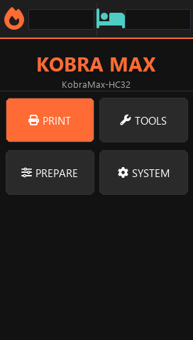
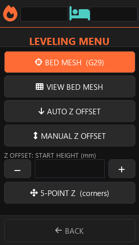
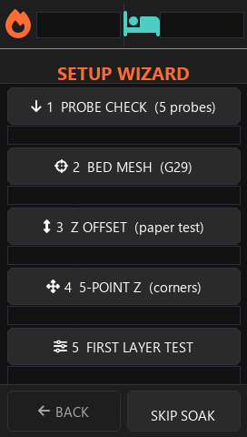
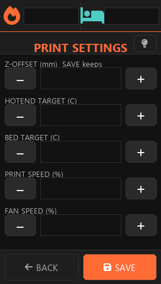

# Kobra Max firmware: Marlin 2.1.2.9 for the HC32F460 board

Community firmware and a redesigned touch screen for the **Anycubic Kobra Max** (TriGorilla Pro A mainboard, HC32F460 processor,
DWIN DGUS II 272 x 480 touch display, strain-gauge nozzle probe). It is Marlin 2.1.2.9 with the HC32 HAL, plus a rewritten
display driver and a set of guided set-up tools. Everything is built from this repository with scripts, no vendor IDE needed.

> **Based on [Marlin Firmware](https://github.com/MarlinFirmware/Marlin) 2.1.2.9** (GPLv3), the parent of this firmware.
> Also derived from: Anycubic's official [Kobra_Max](https://github.com/ANYCUBIC-3D/Kobra_Max) firmware and DGUS display library, and
> [wabbitguy's Kobra Max fork](https://github.com/wabbitguy/Kobra_Max). Credits and licence are at the end of this file.

**Lineage.** This is a GitHub fork of Anycubic's [Kobra_Max](https://github.com/ANYCUBIC-3D/Kobra_Max). The code started from [wabbitguy's Kobra Max fork](https://github.com/wabbitguy/Kobra_Max) (Marlin 2.0.8, itself
based on Anycubic's firmware) and its history is kept. This branch is now an independent project: a new Marlin 2.1.2.9 base with the
HC32 HAL, a rewritten display driver and display set, and its own tools and releases. It does not track or merge wabbitguy's
repository, so the two are not interchangeable; wabbitguy's older firmware is the one for the original TriGorilla board.

* **`main`** holds the latest tested release (Marlin 2.1.2.9). **`kobra-max-hc32-2.1`** is where development happens; it is merged into
  `main` when a release has been built and tried on the printer. `kobra-max-hc32` (Marlin 2.0.8) stays as an older fallback.
  `master` is Anycubic's own `Kobra_Max` code: this repository is a GitHub fork of it, and `master` is left untouched.
* Recommended release: **`release_v83`** (tag `release_v83`, see [Releases](#releases)).
* Touch screen manual with a picture of every screen: **[docs/MANUAL.md](docs/MANUAL.md)**.
* First-time set-up of a printer: **[docs/SETUP.md](docs/SETUP.md)**.

| | | |
|---|---|---|
|  |  |  |

> **Read this first.** This is a hobby project developed by one person on one printer. It is not an Anycubic product, it may void
> your warranty, and flashing a printer is done at your own risk. The parts that have been used on a printer are listed under
> [Status](#status); everything newer is marked untested. Stay next to the printer for the first homing and the first print, with a
> hand on the power switch.

---

## What you get

* **Marlin 2.1.2.9** (GPLv3) on the HC32F460 with Kobra Max clock, serial, SD and endstop fixes.
* **9 x 9 bed mesh** (81 points) with outlier re-probing, **mesh normalised** to the Z home offset, and a stale-mesh check that refuses
  to lower the nozzle when the bed is not where the mesh says.
* **Guided set-up** on the touch screen: probe check, bed mesh, hot paper test for the Z offset, 5-point corner corrections and a
  first-layer test that prints five squares ([setup wizard](docs/MANUAL.md#setup-wizard)).
* **Settings in the chip's own flash**, not on the SD card: mesh, Z offset, PID, E-steps, K and wizard progress survive re-flashing.
* **Redesigned touch screen:** file browser with folders and path, live print settings, thermal tuning (PID), E-steps calibration,
  linear advance K test, bed mesh viewer, terminal with an on-screen keyboard, statistics, power-loss recovery, factory reset.
* **Case light, filament runout sensor, power-loss recovery and M600** filament change supported.
* **Reproducible releases:** `tools/build_release.py` builds the firmware, regenerates and cross-checks every display file and
  writes a package with flashing instructions. A release folder appears only when every check passed.

### Screens at a glance

| Setup wizard | Z offset paper test | Bed mesh view | Print settings |
|---|---|---|---|
|  |  |  |  |

All other screens, button by button: [docs/MANUAL.md](docs/MANUAL.md).

---

## Hardware this is for

* Anycubic **Kobra Max** with the **TriGorilla Pro A** board (HC32F460, USB type B connector) and the DWIN T5L DGUS II touch display.
* A newer board revision with a micro-USB connector (TriGorilla Pro B): the original 2.0.8 notes ([docs/LEGACY_2.0.8.md](docs/LEGACY_2.0.8.md))
  report that Anycubic's firmware did not work on it. It has **not** been tested with this firmware.
* Other Anycubic printers (Kobra, Kobra Go, Kobra 2) are **not** supported.

---

## Install

**You need:** a Kobra Max with the TriGorilla Pro A board; **one microSD card** (a second one is optional) and a card reader; a PC to format the card
(Windows: `format X: /q /fs:fat32 /a:4096`; elsewhere any tool that makes FAT32 with 4096-byte clusters); a strip of paper and a hex
key (to check that the print head is tight); about two hours for flashing and the first set-up. No programmer or IDE is needed to flash.
Keep a copy of the stock firmware and display files first (see [Going back to stock](#going-back-to-stock-firmware)).

**Download a release:** the [latest release](https://github.com/colneech-dev/Kobra_Max/releases/latest) (all releases:
[Releases page](https://github.com/colneech-dev/Kobra_Max/releases)). The zip holds `firmware.bin` and the `DWIN_SET` folder, nothing else; both
are also offered separately, with `SHA256SUMS.txt` to check them (`certutil -hashfile <file> SHA256` on Windows, `sha256sum -c SHA256SUMS.txt` elsewhere). You can also build one yourself (see [Build](#build)); release folders are not stored in the repository (they are
git-ignored). **Do not copy this repository's own `DWIN_SET/` folder to the display:** it holds source files with the stock names; the
release's `DWIN_SET/` is the one to flash.

You need **one SD card**, FAT32 with 4096-byte clusters. The display and the mainboard are flashed in turn, and the same card can
hold the release's `DWIN_SET` folder and `firmware.bin` (move the card between the display's slot and the printer's front slot). A
second card does the same job if you prefer to keep them apart. The display files and the firmware must come from the **same release
folder**.

1. **Get a release** (see above). A release folder you built has a `README.txt` with the exact steps for that release. Check that
   `firmware.bin` is about 194 KB: an empty or tiny file has caused a failed flash before.
2. **Flash the display first.** The SD card (FAT32, 4096-byte clusters) with the release's `DWIN_SET` folder at the root.
   Put it in the slot on the back of the display, power on, wait for the blue "END !" screen, power off for 15 to 20 seconds.
3. **Flash the mainboard.** Copy `firmware.bin` to the root of the card, put the card in the printer's front slot, power on. The printer renames the file to
   `firmware.cur` after it has flashed it.
4. **Check** System > ABOUT: it must show the release name (`display set: release_vN`) and the build id.
5. **Set up** the printer with the [setup wizard](docs/SETUP.md): probe check, mesh, Z offset, 5-point, first layer test.

If the display is blank or garbled after a flash: power off, wait 15 to 20 seconds, flash the last set that worked.
Before flashing, send `M503` from a host or the Terminal and keep the output (your old settings).

### Backing up and restoring settings

`M503` prints the settings. To restore after a reset, send the `M92` (E-steps), `M301` and `M304` (PID), `M851` (Z probe offset),
`M206` (home offset) and `M900` (linear advance K) lines from your saved output, then `M500`. The bed mesh is not worth restoring from
text (it is tied to the Z offset and the bed condition): make a new one. A new release can change the settings layout; the firmware then
restores defaults, so back up before each upgrade.

### Going back to stock firmware

Flash Anycubic's own display files and `firmware.bin` (from [ANYCUBIC-3D/Kobra_Max](https://github.com/ANYCUBIC-3D/Kobra_Max)) the same
way: display card first, then the printer's card, with the 15 to 20 second power-off between. The settings this firmware keeps in two
chip-flash sectors (`0x3C000`, `0x3E000`) are not used by the stock firmware. **This has not been tried on a printer** from this
project: keep the stock files, and expect to redo the stock set-up.

### What can go wrong

* A bad display flash leaves the screen blank or garbled but the printer still runs: power off, wait 15 to 20 seconds, flash a set that
  worked. The most common cause is an SD card with the wrong cluster size.
* An empty or truncated `firmware.bin` fails to flash; the file is only renamed to `firmware.cur` after a successful start.
* Display files and firmware from different releases mis-route buttons: always flash both from the same release.
* Nothing here has been tested on the TriGorilla Pro B board.

Full details and troubleshooting: [docs/SETUP.md](docs/SETUP.md). The display's file layout and quirks: [docs/DISPLAY_NOTES.md](docs/DISPLAY_NOTES.md).

---

## Status

Developed and tested on one Kobra Max, 2026 (state as of release_v83, November 2026).

| Area | State |
|---|---|
| Boot, serial, touch, navigation, heaters, steppers, SD printing | Used on hardware |
| 9 x 9 mesh, probe check, Z offset page, wizard, first-layer test (five squares printed well) | Used on hardware |
| Flash settings, file browser, Terminal, thermal tuning, PID, case light, filament runout | Used on hardware |
| File browser folders (folders listed last), the folder path in the title bar, printing from a folder | Used on hardware |
| Lit buttons for the chosen preset or running action (Preheat, 5-point corners, Filament, K TEST, Thermal tuning, wizard) | Preheat and K TEST used; others built, in use since v81 |
| Page-change read-back, Z page limit (2.5 mm below paper level), `Z offset:` log lines, serial flush before a flash save (v70-v75) | Built, in use since v75, not tested separately |
| E-steps page, K test, pause and resume, PID tuning | Used on hardware (E-steps 420.90, K 0.60 on one printer) |
| Power-loss recovery: layer saves, outage-sensor save, resume from the top level and from a folder, two alternating recovery files (v82, v83) | Used on hardware with real power cuts |
| 5-point Z corrections | Built, little or no printing done with them |

The last release that was used for longer test sessions before v70 is `release_v69`.

### Known issues

* **Stuck "Probing 0/81" page** seen once after a mesh run; the cause was not found (v70 adds a read-back that resends the page change).
* **One reset during G29** was seen; the reset reason was not captured.
* **`Unknown command: "105"`** (the leading `M` lost) can happen when the host sends while the printer is busy.
* **The Z offset depends on how stiff the print head and bed are.** A loose print head gave a probe offset of 1.5 to 2.4 mm and a mesh
  with a trough; after tightening it the offset was 0.11 mm and the mesh smooth. Tighten the head before levelling.
* **The stale-mesh check can refuse** ("Mesh off by x.xx mm") when a single probe approaches a point from a different side than G29;
  differences of 0.5 mm were seen. Make a new mesh if it keeps refusing.
* **The display drops text** sent right after a page change; the firmware resends where it matters, but a screen may rarely need a tap.
* **A save during a print is held** in memory and written when the printer is idle (a power cut before then loses it).
* The firmware (about 194 KB) uses 91 % of the 208 KB the build allows; the last two 8 KB sectors of the chip hold the settings. The
  build is sized for a 256 KB part.
* **Power-loss recovery** has been tried with real power cuts on one printer (from the top level and from a folder). On RESUME the printer
  lifts 5 mm, homes and continues; check that the nozzle is clear of the part, and do not rely on it for valuable prints.
* **Thermal protection** is at Marlin's defaults (hotend 40 s / 4 C, bed 60 s); a false "thermal runaway" halt is possible with a
  part-cooling fan (revert the setting in `Configuration_adv.h` if so).
* The CI workflow on GitHub (`.github/workflows/display-and-firmware.yml`) regenerates and checks the display files, builds the firmware on a clean machine and checks the framework package hashes and the vector table. It was green on 2026-11-16 (firmware build 176 s, flash 92.2 %). It runs on every push (workflows had to be enabled once in the Actions tab of the fork) and can be started by hand (Actions > display-and-firmware > Run workflow). The firmware job is still marked allowed-to-fail, because the PlatformIO downloads can be flaky, so check it rather than trusting a green overall result. Releases are built locally with `tools/build_release.py`.
* The notes under `docs/history/` are working notes from earlier releases and are not maintained.

Calibration order: tighten the print head, probe check, mesh, Z offset, 5-point, first-layer test, PID, E-steps, linear advance.
Open items and review notes: [docs/history/OPEN_ITEMS.md](docs/history/OPEN_ITEMS.md), [docs/REVIEW_PLAN_2026-11-12.md](docs/REVIEW_PLAN_2026-11-12.md).

---

## Safety

* **Temperature limits** follow Anycubic's rating (nozzle 260 C, bed 90 C); the firmware stops at `HEATER_0_MAXTEMP 275` and
  `BED_MAXTEMP 100`. Check them against your own hardware before printing unattended.
* The nozzle is **hot** during the paper test and the 5-point page.
* Thermal runaway protection and the heater fault pages are active; do not print unattended on a new build.
* After flashing, run `M119` in the Terminal, press the Z input by hand and run `M119` again: the Z line must change. Do this before
  the first homing of a new build.

---

## Build

Requirements: Windows or Linux, Python 3, [PlatformIO](https://platformio.org/), `pip install -r tools/requirements.txt`, and the
Segoe UI font for the display art (Windows has it; elsewhere see `tools/fonts/README.md`).

```
python tools/build_release.py --out release_vN --script-icl
```

Run it from a clean, committed tree. It builds the firmware (`pio run`, environment `HC32F460E_kobra_max`, about 8 to 10 minutes),
regenerates every display file, cross-checks them, builds the picture and icon libraries and writes `release_vN/` with a README. It
fails and leaves no folder when a check fails or when a tracked file changes during the build. `python tools/build_release.py
--package-hashes` prints the hashes of the PlatformIO framework packages, which release builds compare with
`tools/expected_package_hashes.json` (the packages must be pristine).

`python tools/package_release.py release_vN OUT_DIR` makes the download files (zip, `firmware.bin`, `DWIN_SET.zip`, `SHA256SUMS.txt`) from a release folder.
Pushing a tag `release_v*` also runs the `release` workflow, which builds the package on GitHub and creates a **draft** release for a new tag (it never
publishes by itself, and leaves a tag that already has a release alone).

`M115` reports `2.1.2.9-hc32-<git hash>` (`-dirty` for uncommitted changes).

### Repository layout

| Path | What |
|---|---|
| `source/Marlin/` | Marlin 2.1.2.9 plus the HC32 HAL and the Kobra Max display driver (`src/lcd/extui/lib/anycubic_dgus/`) |
| `source/Marlin/Configuration.h` | Printer configuration (probe offset, limits, preheat presets, mesh size) |
| `DWIN_SET/` | Display files (generated: touch zones, show file, pictures) |
| `tools/` | Generators and checks: `generate_screens.py`, `generate_dwin_controls.py`, `patch_14showfile.py`, `build_icl.py`, `cross_check_display.py`, `build_release.py` |
| `docs/` | [MANUAL](docs/MANUAL.md), [SETUP](docs/SETUP.md), [DISPLAY_NOTES](docs/DISPLAY_NOTES.md), plans and review notes |
| `release_vN/` | Built release packages (kept locally; the latest recommended one is named above) |
| `platformio.ini` | PlatformIO environment, pinned framework packages and libraries |

---

## Releases

| Release | Notes |
|---|---|
| **release_v83** | Recommended. Power-loss recovery tested with real cuts (layer saves every 3 s into two alternating files, outage-sensor save, resume from a folder), lit buttons, folders listed last, Preheat highlight, Marlin folder-path fix, SD sort, `M413 A` power-sense readout. Display files changed: flash both. |
| release_v78 | Last release fully tested before the power-loss work (v79-v83). |
| release_v76 | Same firmware as v75; the release README says one SD card is enough. |
| release_v75 | Folders and path in the file browser, Z page -2.5 mm limit, page-change read-back, `Z offset:` log lines, flash-save serial flush, default Z probe offset 1.0 mm. Display files changed (new title text field). |
| release_v72 | File browser fixes (8.3 names, resend), before folders. |
| release_v69 | Last release used for long test sessions before the v70-v75 changes. |

Every release folder holds `firmware.bin`, `DWIN_SET/` (display files), its own `README.txt` and `SETUP.md`.

---

## Questions

* **Do I need a new mesh before every print?** No. Make one when the bed or plate changes; the stale-mesh check tells you.
* **Different bed surface or plate?** Redo the mesh, the Z offset and the 5-point corrections.
* **Can I print from OctoPrint or Pronterface?** A USB host can send G-code; the Pause / Resume / Stop buttons only act on prints from the SD card.
* **Where are my settings?** In the chip's flash, not on the SD card.

## Reporting problems and contributing

When you report a problem, include the build id and display set from System > ABOUT, the `M115` line, your `M503` output and the
Terminal log. Test reports from other Kobra Max printers are the most useful contribution: say which release and which pages you used.
Display changes are made in `tools/` (`ui_features.py`, `generate_screens.py`, `patch_14showfile.py`) and checked by
`tools/build_release.py`; keep the tree committed and clean when you build. Release source is the commit named in the release's
`README.txt`.

## Credits and licence

[Marlin Firmware](https://github.com/MarlinFirmware/Marlin) (GPLv3); Anycubic's official
[Kobra_Max](https://github.com/ANYCUBIC-3D/Kobra_Max) firmware and DGUS display library; wabbitguy's community fork
([wabbitguy/Kobra_Max](https://github.com/wabbitguy/Kobra_Max)), the starting point of this repository, whose original notes for the Marlin 2.0.8 firmware are kept in
[docs/LEGACY_2.0.8.md](docs/LEGACY_2.0.8.md); the HC32F460 HAL for Marlin by shadow578 and contributors
(`shadow578/framework-arduino-hc32f46x`); the 2.1.2.9 port, the display redesign and the tools by colneech-dev.

Licensed under the **GNU General Public License v3** ([LICENSE](LICENSE)). Not affiliated with Anycubic. The display art uses Font
Awesome icons and is drawn with the Segoe UI font on the build machine (the font is not included); the display files derive from the
Anycubic and wabbitguy display sets. `firmware.bin` is a derivative of GPL code; the source of a release is its commit.
