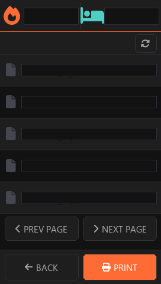
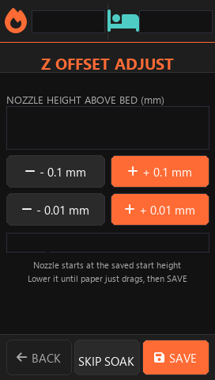
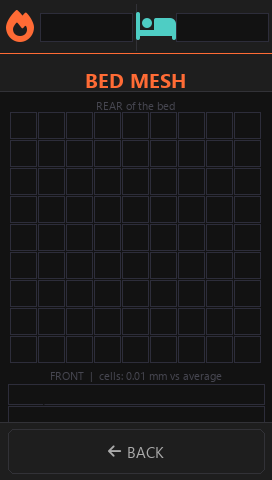

# Kobra Max firmware: Marlin 2.1.2.9 for the HC32F460 board

Community firmware and a redesigned touch screen for the **Anycubic Kobra Max** (TriGorilla Pro A mainboard, HC32F460 processor,
DWIN DGUS II 272 x 480 touch display, strain-gauge nozzle probe). It is Marlin 2.1.2.9 with the HC32 HAL, plus a rewritten
display driver and a set of guided set-up tools. Everything is built from this repository with scripts, no vendor IDE needed.

* Branch: `kobra-max-hc32-2.1` (the newer line). `kobra-max-hc32` (Marlin 2.0.8) stays as an older fallback.
* Recommended release: **`release_v75`** (built from this branch, see [Releases](#releases)).
* Touch screen manual with a picture of every screen: **[docs/MANUAL.md](docs/MANUAL.md)**.
* First-time set-up of a printer: **[docs/SETUP.md](docs/SETUP.md)**.

| | | |
|---|---|---|
|  |  |  |

> **Read this first.** This is a hobby project developed by one person on one printer. It is not an Anycubic product, it may void
> your warranty, and flashing a printer is done at your own risk. The parts that have been used on a printer are listed under
> [Status](#status); everything newer is marked untested. Stay next to the printer for the first homing and the first print, with a
> hand on the power switch.

---

## What you get

* **Marlin 2.1.2.9** (GPLv3) on the HC32F460 with Kobra Max clock, serial, SD and endstop fixes.
* **9 x 9 bed mesh** (81 points) with outlier re-probing, **mesh normalised** to the Z home offset, and a stale-mesh check that refuses
  to lower the nozzle when the bed is not where the mesh says.
* **Guided set-up** on the touch screen: probe check, bed mesh, hot paper test for the Z offset, 5-point corner corrections and a
  first-layer test that prints five squares ([setup wizard](docs/MANUAL.md#setup-wizard)).
* **Settings in the chip's own flash**, not on the SD card: mesh, Z offset, PID, E-steps, K and wizard progress survive re-flashing.
* **Redesigned touch screen:** file browser with folders and path, live print settings, thermal tuning (PID), E-steps calibration,
  linear advance K test, bed mesh viewer, terminal with an on-screen keyboard, statistics, power-loss recovery, factory reset.
* **Case light, filament runout sensor, power-loss recovery and M600** filament change supported.
* **Reproducible releases:** `tools/build_release.py` builds the firmware, regenerates and cross-checks every display file and
  writes a package with flashing instructions. A release folder appears only when every check passed.

### Screens at a glance

| Setup wizard | Z offset paper test | Bed mesh view | Print settings |
|---|---|---|---|
|  |  |  |  |

All other screens, button by button: [docs/MANUAL.md](docs/MANUAL.md).

---

## Hardware this is for

* Anycubic **Kobra Max** with the **TriGorilla Pro A** board (HC32F460, 256 KB flash) and the DWIN T5L DGUS II touch display.
* A newer board revision with a micro-USB connector (TriGorilla Pro B) is reported to be different: it has **not** been tested.
* Other Anycubic printers (Kobra, Kobra Go, Kobra 2) are **not** supported.

---

## Install

You need **two SD cards**: one for the display and the printer's own card for the firmware. The display files and the firmware must
come from the **same release folder**.

1. **Get a release.** Build one (see [Build](#build)) or use a `release_vN` folder you were given. Each folder has a `README.txt`
   with the exact steps for that release.
2. **Flash the display first.** A separate SD card, FAT32 with 4096-byte clusters, with the release's `DWIN_SET` folder at the root.
   Put it in the slot on the back of the display, power on, wait for the blue "END !" screen, power off for 15 to 20 seconds.
3. **Flash the mainboard.** Copy `firmware.bin` to the printer's own SD card (front slot), power on. The printer renames the file to
   `firmware.cur` after it has flashed it.
4. **Check** System > ABOUT: it must show the release name (`display set: release_vN`) and the build id.
5. **Set up** the printer with the [setup wizard](docs/SETUP.md): probe check, mesh, Z offset, 5-point, first layer test.

If the display is blank or garbled after a flash: power off, wait 15 to 20 seconds, flash the last set that worked.
Before flashing, send `M503` from a host or the Terminal and keep the output (your old settings).

Full details and troubleshooting: [docs/SETUP.md](docs/SETUP.md). The display's file layout and quirks: [docs/DISPLAY_NOTES.md](docs/DISPLAY_NOTES.md).

---

## Status

Developed and tested on one Kobra Max, 2026.

| Area | State |
|---|---|
| Boot, serial, touch, navigation, heaters, steppers, SD printing | Used on hardware |
| 9 x 9 mesh, probe check, Z offset page, wizard, first-layer test (five squares printed well) | Used on hardware |
| Flash settings, file browser, Terminal, thermal tuning, PID, case light, filament runout | Used on hardware |
| File browser folders and the folder path in the title bar (release_v75) | Reported working, printing from inside a folder not confirmed |
| Page-change read-back, Z page -2.5 mm limit, `Z offset:` log lines, serial flush before a flash save (v70-v75) | Built, in use since v75, not tested separately |
| 5-point Z corrections, K test, E-steps page, power-loss resume | Built, little or no printing done with them |

The last release that was used for longer test sessions before v70 is `release_v69`.

### Known issues

* **Stuck "Probing 0/81" page** seen once after a mesh run; the cause was not found (v70 adds a read-back that resends the page change).
* **One reset during G29** was seen; the reset reason was not captured.
* **`Unknown command: "105"`** (the leading `M` lost) can happen when the host sends while the printer is busy.
* **The Z offset depends on how stiff the print head and bed are.** A loose print head gave a probe offset of 1.5 to 2.4 mm and a mesh
  with a trough; after tightening it the offset was 0.11 mm and the mesh smooth. Tighten the head before levelling.
* **The stale-mesh check can refuse** ("Mesh off by x.xx mm") when a single probe approaches a point from a different side than G29;
  differences of 0.5 mm were seen. Make a new mesh if it keeps refusing.
* **The display drops text** sent right after a page change; the firmware resends where it matters, but a screen may rarely need a tap.
* **A save during a print is held** in memory and written when the printer is idle (a power cut before then loses it).
* The watchdog timeout (about 21 s) has not been tuned. The firmware uses 90.7 % of the 256 KB flash.
* The CI workflow on GitHub (`.github/workflows/display-and-firmware.yml`) had not run successfully before the last fix.

Open items and review notes: [docs/OPEN_ITEMS.md](docs/OPEN_ITEMS.md), [docs/REVIEW_PLAN_2026-11-12.md](docs/REVIEW_PLAN_2026-11-12.md).

---

## Safety

* **Temperature limits** follow Anycubic's rating (nozzle 260 C, bed 90 C); the firmware stops at `HEATER_0_MAXTEMP 275` and
  `BED_MAXTEMP 100`. Check them against your own hardware before printing unattended.
* The nozzle is **hot** during the paper test and the 5-point page.
* Thermal runaway protection and the heater fault pages are active; do not print unattended on a new build.
* After flashing, run `M119` in the Terminal, press the Z input by hand and run `M119` again: the Z line must change. Do this before
  the first homing of a new build.

---

## Build

Requirements: Windows or Linux, Python 3, [PlatformIO](https://platformio.org/), `pip install -r tools/requirements.txt`, and the
Segoe UI font for the display art (Windows has it; elsewhere see `tools/fonts/README.md`).

```
python tools/build_release.py --out release_vN --script-icl
```

Run it from a clean, committed tree. It builds the firmware (`pio run`, environment `HC32F460E_kobra_max`, about 8 to 10 minutes),
regenerates every display file, cross-checks them, builds the picture and icon libraries and writes `release_vN/` with a README. It
fails and leaves no folder when a check fails or when a tracked file changes during the build. `python tools/build_release.py
--package-hashes` prints the hashes of the PlatformIO framework packages, which release builds compare with
`tools/expected_package_hashes.json` (the packages must be pristine).

`M115` reports `2.1.2.9-hc32-<git hash>` (`-dirty` for uncommitted changes).

### Repository layout

| Path | What |
|---|---|
| `source/Marlin/` | Marlin 2.1.2.9 plus the HC32 HAL and the Kobra Max display driver (`src/lcd/extui/lib/anycubic_dgus/`) |
| `source/Marlin/Configuration.h` | Printer configuration (probe offset, limits, preheat presets, mesh size) |
| `DWIN_SET/` | Display files (generated: touch zones, show file, pictures) |
| `tools/` | Generators and checks: `generate_screens.py`, `generate_dwin_controls.py`, `patch_14showfile.py`, `build_icl.py`, `cross_check_display.py`, `build_release.py` |
| `docs/` | [MANUAL](docs/MANUAL.md), [SETUP](docs/SETUP.md), [DISPLAY_NOTES](docs/DISPLAY_NOTES.md), plans and review notes |
| `release_vN/` | Built release packages (kept locally; the latest recommended one is named above) |
| `platformio.ini` | PlatformIO environment, pinned framework packages and libraries |

---

## Releases

| Release | Notes |
|---|---|
| **release_v75** | Recommended. Folders and path in the file browser, Z page -2.5 mm limit, page-change read-back, `Z offset:` log lines, flash-save serial flush, default Z probe offset 1.0 mm. Display files changed (new title text field). |
| release_v72 | File browser fixes (8.3 names, resend), before folders. |
| release_v69 | Last release used for long test sessions before the v70-v75 changes. |

Every release folder holds `firmware.bin`, `DWIN_SET/` (display files), its own `README.txt` and `SETUP.md`.

---

## Credits and licence

[Marlin Firmware](https://github.com/MarlinFirmware/Marlin) (GPLv3); Anycubic's official
[Kobra_Max](https://github.com/ANYCUBIC-3D/Kobra_Max) firmware and DGUS display library; wabbitguy's community fork
([wabbitguy/Kobra_Max](https://github.com/wabbitguy/Kobra_Max)), whose original notes for the Marlin 2.0.8 firmware are kept in
[docs/LEGACY_2.0.8.md](docs/LEGACY_2.0.8.md); the HC32F460 HAL for Marlin by shadow578 and contributors
(`shadow578/framework-arduino-hc32f46x`); the 2.1.2.9 port, the display redesign and the tools by colneech-dev.

Licensed under the **GNU General Public License v3** ([LICENSE](LICENSE)). Not affiliated with Anycubic.
