# Kobra Max touch screen manual

Firmware line: Marlin 2.1.2.9 with the HC32 HAL (branch `kobra-max-hc32-2.1`), recommended release `release_v75`.
This manual describes every screen of the printer's 272 x 480 touch display and what each button does.

**About the pictures.** The screens below are the display art that is flashed to the printer (`DWIN_SET/*.bmp`, drawn by
`tools/generate_screens.py`). The real screen puts live text in the empty dark boxes (temperatures, file names, progress, the Z
value and so on); the pictures show the empty boxes. They are not photos.

**Status bar.** Every screen has a bar at the top with the nozzle temperature (left, flame) and the bed temperature (right, bed).

**Untested parts.** Items marked *(not tested on hardware)* were built and checked by the display cross-check but have not been
run on a printer. Everything else has been used on a Kobra Max.

Contents: [Main](#main-menu) · [Files and printing](#files-and-printing) · [Tools](#tools) · [Prepare](#prepare) ·
[Leveling and Z offset](#leveling-and-z-offset) · [System](#system) · [Messages and errors](#messages-and-error-screens)

---

## Main menu

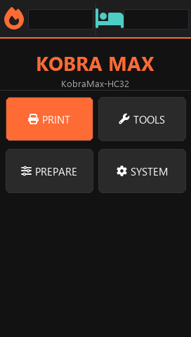

| Button | Does |
|---|---|
| PRINT | Opens the file browser. |
| TOOLS | Move axes, temperature, speed and fan, case light, motors off. |
| PREPARE | Leveling, preheat, filament, thermal tuning, E-steps, linear advance, cool down. |
| SYSTEM | Statistics, sound, About, Terminal, factory reset, setup wizard. |

---

## Files and printing

### File browser

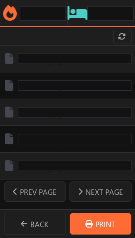

Lists the G-code files on the printer's SD card, five rows at a time. Long names scroll when the row is selected.

* **Tap a file:** selects it; the row gets a `>` marker.
* **Tap a folder** (shown as `/NAME`): opens it. The title bar then shows the path (for example `/MODELS/BENCHY`; long paths show
  the end of the path with `...` in front). Folders open up to 4 levels deep.
* **BACK** (bottom left): goes up one folder. At the top level it returns to the main menu.
* **PREV PAGE / NEXT PAGE:** the previous or next five files.
* **Circular arrow** (title bar, right): re-reads the card and returns to the top level.
* **PRINT:** starts the selected file. Messages appear in the row: `SELECT A FILE FIRST`, `NO LEVEL! PRINT AGAIN?` (no bed mesh in
  memory: press PRINT a second time within 10 s to print anyway), `THAT IS A FOLDER` (only while a print is running; otherwise PRINT on
  a folder opens it).
* Folders cannot be opened or left while a print runs (the running job's folder must stay the current one).
* Files and folders without a long name show their short (8.3) name.

### Printing / Paused

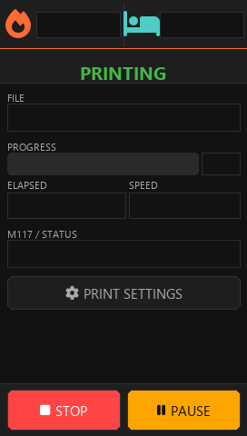 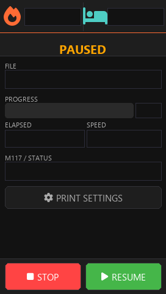

Shows the file name, progress bar and percentage, elapsed time, speed and a status line.

| Button | Does |
|---|---|
| PRINT SETTINGS | Opens the live adjustment page (below). |
| STOP | Asks for confirmation, then stops the print. |
| PAUSE / RESUME | Pauses the print (moves the nozzle out of the way) or resumes it. |

If a filament change (M600) is running the Resume button feeds the new filament and carries on.

### Print settings

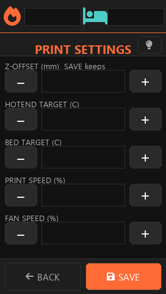 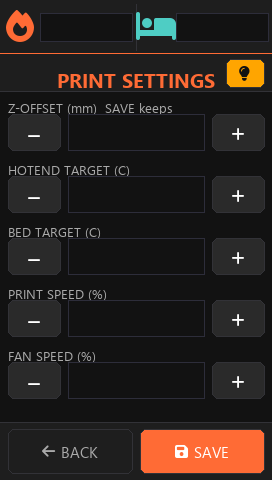

Change values while printing, one row each with `-` and `+`:

| Row | Range / step |
|---|---|
| Z-OFFSET (mm) | Baby-stepping, 0.01 mm per tap. **SAVE** stores it as the Z probe offset. |
| HOTEND TARGET | nozzle temperature |
| BED TARGET | bed temperature |
| PRINT SPEED | percent |
| FAN SPEED | percent |

The bulb button in the title bar switches the case light. BACK discards, SAVE stores.

### Stop confirmation

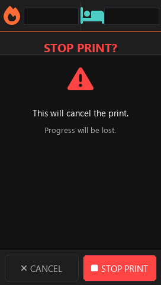

CANCEL goes back to the print, STOP PRINT ends it.

### Print finished

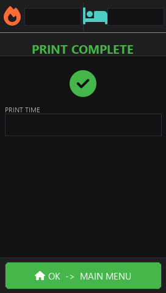

OK returns to the main menu.

### Power-loss recovery

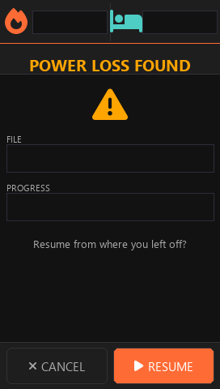

Shown after power came back during a print. It names the file and progress. **RESUME** continues the print, **CANCEL** drops the
recovery. (The recovery file is only written while `M413` is on, which is the default.) The recovery uses the folder the print was
started from.

---

## Tools

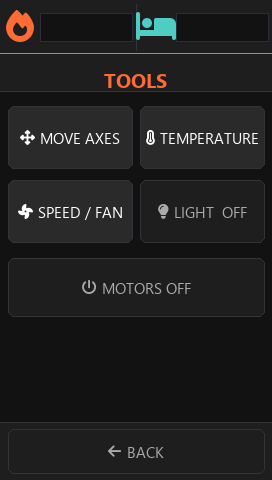

| Button | Does |
|---|---|
| MOVE AXES | Opens the move page. |
| TEMPERATURE | Hotend and bed temperature page. |
| SPEED / FAN | Print speed and fan page. |
| LIGHT | Switches the case light. |
| MOTORS OFF | Releases the stepper motors. |

### Move axes

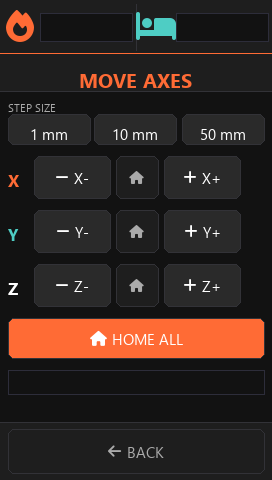

* Step size: **1 mm / 10 mm / 50 mm** (the lit one is active).
* X-, X+, Y-, Y+, Z-, Z+ move by the chosen step.
* HOME X, HOME Y, HOME Z and **HOME ALL**. Moves are refused until the axes are homed: the page says "Not homed: tap HOME ALL".

### Temperature

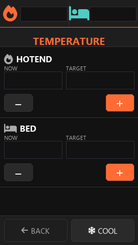

HOTEND and BED targets in 5 degree steps (`-5` / `+5`), applied at once. **COOL** switches both heaters off. Limits follow the
Kobra Max rating: nozzle 260 C, bed 90 C (the firmware stops at 275 C / 100 C).

### Speed and fan

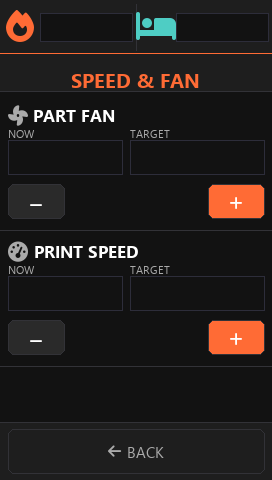

FAN in 5 % steps and SPEED in 5 % steps, applied at once.

---

## Prepare

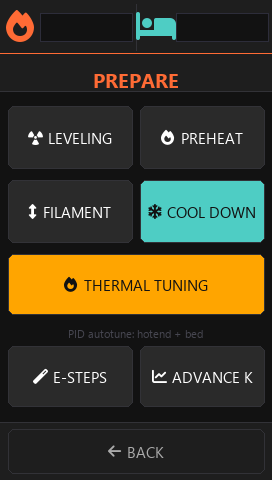

| Button | Does |
|---|---|
| LEVELING | The leveling menu (mesh, Z offset). |
| PREHEAT | Two presets (PLA 204 C / 62 C, PET 230 C / 85 C by default, set in `Configuration.h`). |
| FILAMENT | Load, extrude, unload. |
| COOL DOWN | Both heaters off (not during a print). |
| THERMAL TUNING | PID autotune of the hotend and the bed. |
| E-STEPS | Calibrate the extruder steps per mm. |
| ADVANCE K | Linear advance factor and K test pattern. |

### Preheat

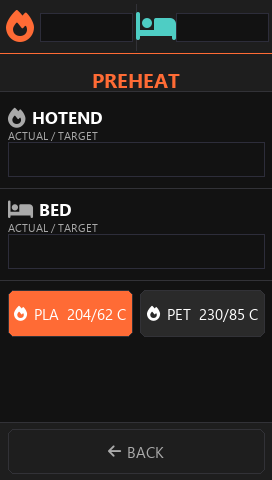

Tap a preset to heat the nozzle and bed to it.

### Filament

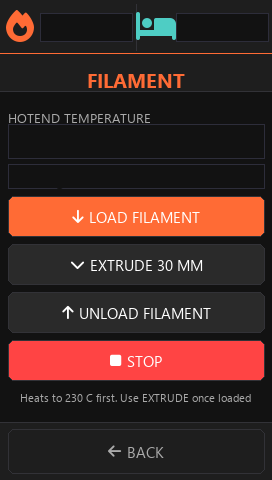

**LOAD FILAMENT**, **EXTRUDE 30 MM**, **UNLOAD FILAMENT** and **STOP**. The page shows the nozzle temperature and a status line;
the nozzle heats to the filament temperature first (the page says what it heats to). Use EXTRUDE once the filament is loaded.

### Thermal tuning

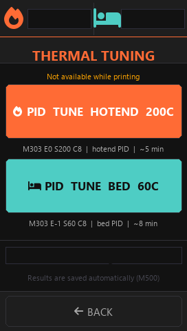

Runs PID autotune for the hotend or the bed (about 5 and 8 minutes). The results are saved automatically.

### E-steps calibration

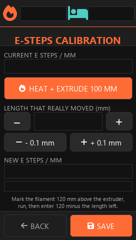

1. Mark the filament 120 mm above the extruder.
2. **HEAT + EXTRUDE 100 MM**.
3. Measure what is left and enter 120 minus that with the `-1 / +1 / -0.1 / +0.1` buttons.
4. **SAVE**. The new steps per mm shows on the page.

### Linear advance (ADVANCE K)

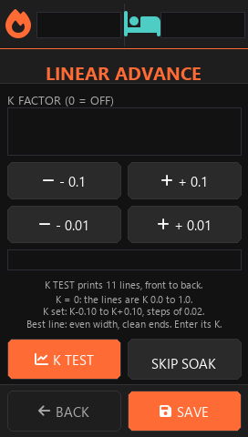

Set K with `-0.1 / +0.1 / -0.01 / +0.01`, **K TEST** prints 11 lines to pick the best K from (with K = 0: K 0.0 to 1.0; with a K set:
K-0.10 to K+0.10), **SKIP SOAK** skips the heat soak, **SAVE** stores it. Bowden tubes typically need K of about 0.5 to 1.5.

---

## Leveling and Z offset

### Leveling menu

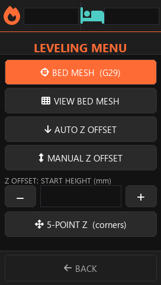

| Button | Does |
|---|---|
| BED MESH (G29) | Makes a new 9 x 9 mesh (81 probe points, about 30 minutes; it asks for confirmation first). |
| VIEW BED MESH | Shows the mesh as a grid of numbers with its range, lowest and highest point. |
| AUTO Z OFFSET | Makes a mesh if none exists, tests the probe, then continues as the manual page. |
| MANUAL Z OFFSET | The paper test at the bed centre (below). |
| Start height - / + | The height the nozzle starts the paper test at (default 1.0 mm, minimum 0.3 mm). |
| 5-POINT Z (corners) | Corner corrections for the mesh. |

### Bed mesh confirmation and progress

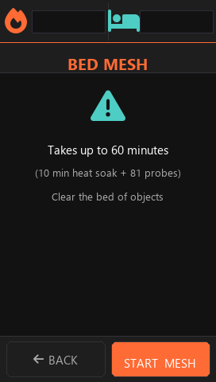 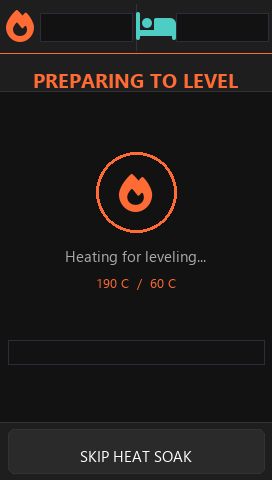 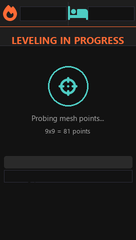

Every way into a mesh asks first. The bed and nozzle heat (60 C / 190 C) and soak for 10 minutes; **SKIP HEAT SOAK** skips the soak.
During the run the page shows `Probing n/81`. After the run, the worst points are probed again (`Re-checking n/4`) and replaced when the
second reading disagrees by more than 0.25 mm. Settings and the mesh are saved at the end.

### Mesh viewer

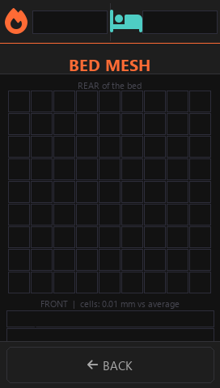

A 9 x 9 grid of the 81 mesh points (REAR of the bed at the top, FRONT at the bottom). Each cell is the height in 0.01 mm against
the average. Below it: the range (highest minus lowest) and the lowest and highest point. A good mesh on a rigid bed has a range
of about 1 mm or less.

### Z offset (paper test)

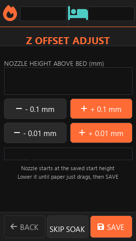

Done HOT (190 C / 60 C), after the mesh. The page homes, parks the nozzle 5 mm above the centre, heats, then lowers to the start
height. Use a strip of paper (the nozzle is hot). Lower the nozzle with the `-0.1` / `-0.01` buttons until the paper just drags,
then **SAVE**. SAVE stores the offset (the page shows "SAVE stores offset x.xx"). **BACK** cancels, **SKIP SOAK** ends the heat wait.
The page can lower by up to 2.5 mm from the start per visit. If the printer says "Mesh off by x.xx mm: redo", the bed is not where the
mesh says (for example, a loose print head or a new plate): make a new mesh. If it says "Paper test is failing. Offset too high",
the nozzle already touched before the paper did.

### 5-point Z

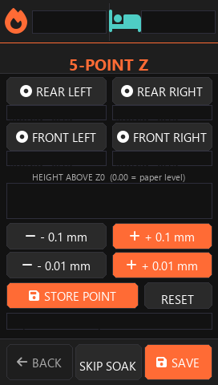

Paper test at the four corners (REAR LEFT, REAR RIGHT, FRONT LEFT, FRONT RIGHT). Tap a corner, lower the nozzle until the paper
drags, **STORE THIS POINT**. The corrections become a smooth surface over the mesh (at most 0.3 mm, zero at the centre).
**RESET** removes all saved corrections, **SAVE** stores them, **BACK** discards unsaved ones. Redo after every new mesh.

### Setup wizard

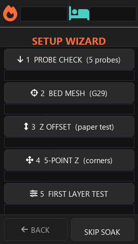

Five steps, done in order: (1) PROBE CHECK, (2) BED MESH, (3) Z OFFSET, (4) 5-POINT Z, (5) FIRST LAYER TEST. Each step shows its
status; finished steps are remembered. The first test prints five 24 mm squares one layer high. Details: [SETUP.md](SETUP.md).

### Probe test pages

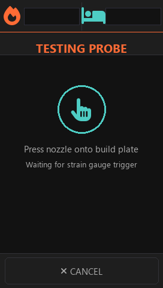 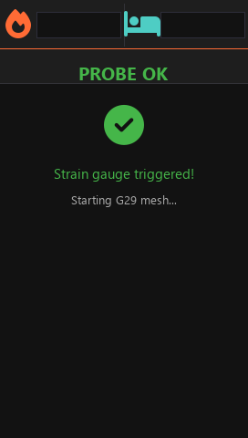 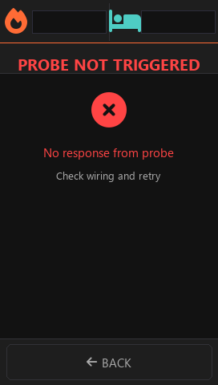

The probe check (wizard step 1) touches the bed five times at the centre and reports the spread: OK up to 0.03 mm, FAIR up to
0.08 mm, NOISY above. A failed probe check returns to the leveling menu.

### Leveling errors

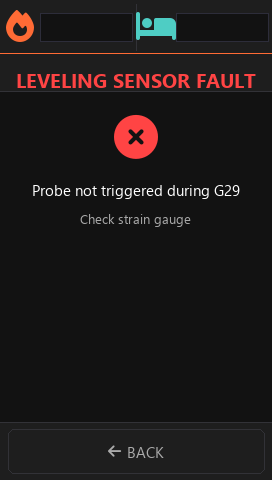

Shown when the probe does not trigger during G29. BACK returns to the leveling menu.

---

## System

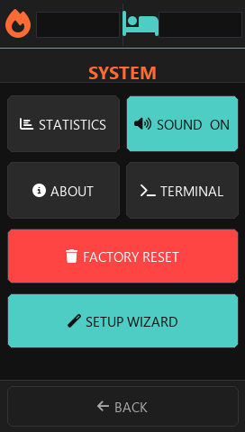

| Button | Does |
|---|---|
| STATISTICS | Total prints, finished, failed, total time, longest print and filament used. |
| AUDIO | Switches the sounds on or off (a muted page layout is used). |
| ABOUT | Firmware version and the display set the firmware expects. |
| TERMINAL | G-code console with an on-screen keyboard. |
| FACTORY RESET | Confirmation page; resets every setting to its default (see below). |
| SETUP WIZARD | The five-step setup. |

### Statistics and About

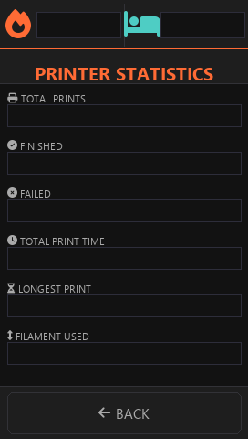 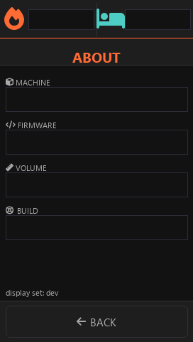

About shows the firmware build id and `display set: release_vN`. If the display set is from another release than the firmware,
flash both parts again from the same release folder.

### Terminal

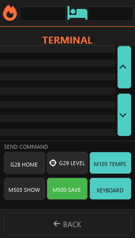 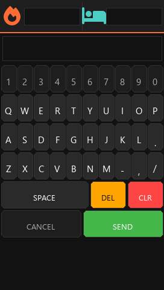

The log shows the last 13 lines the printer sent (6 x 12 pixel text). Preset buttons: **G28 HOME, G29 LEVEL, M105 TEMPS, M503 SHOW
(settings), M500 SAVE**, and **KEYBOARD** which opens an on-screen keyboard for any G-code. The arrow buttons scroll the log.
The keyboard blocks long waits (M109 / M190). `M502` (reset) is deliberately not on a button: use FACTORY RESET.

### Factory reset

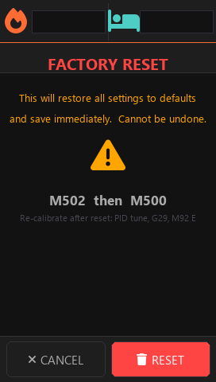

RESET restores every setting to its default (`M502` + `M500`): the mesh, Z offset, PID, E-steps and K are lost. CANCEL goes back.
After a reset the default Z probe offset is 1.0 mm; make a new mesh and run the paper test.

---

## Messages and error screens

| Screen | Meaning |
|---|---|
| 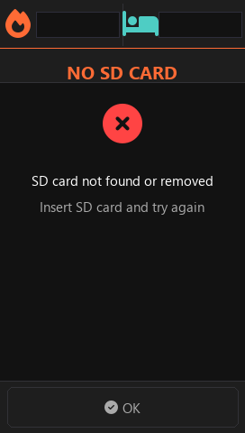 | No SD card in the printer's slot (the slot on the printer, not the one on the display). |
| 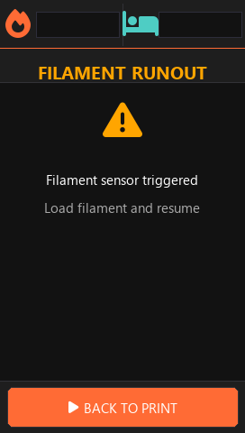 | The filament runout sensor sees no filament. Load filament and go back to the print. |
| 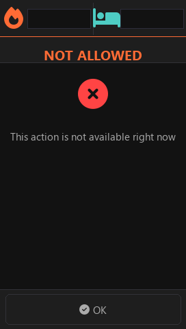 | The action is not allowed right now (for example while printing). |
| 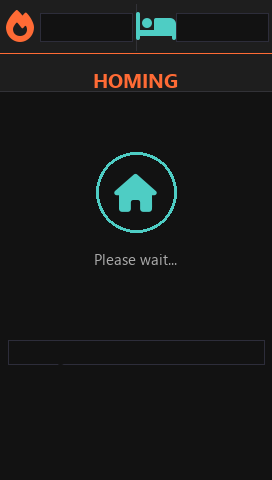 | The printer is homing; it cannot be cancelled. |
| 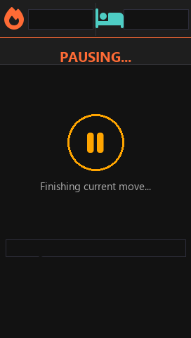 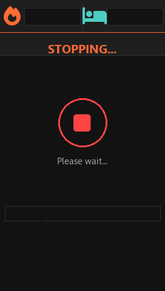 | Wait pages while a pause or stop completes. |
| 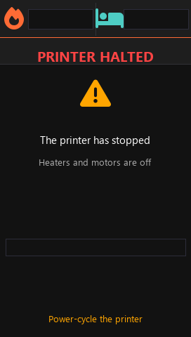 | The printer stopped on a fault (heater, thermistor, endstop). Power-cycle after fixing the cause. The page names the fault. |

---

## Good to know

* **Settings live in the chip flash**, not on the SD card, and survive re-flashing (mesh, Z offset, PID, E-steps, K, 5-point
  corrections, wizard progress).
* **Saves wait for the end of a print.** A save while printing is held in memory and written when the printer is idle; a power cut
  before then loses it.
* **The display drops text sent right after a page change.** The firmware resends the file names and the path, and reads back the
  page after a mesh run, so rarely a screen can need a second tap.
* **Z offset depends on how stiff the print head and bed are.** A loose print head gave offsets of 1.5 to 2.4 mm and a mesh with a
  trough; after tightening it the offset was 0.11 mm and the mesh smooth. Tighten the head before levelling.
